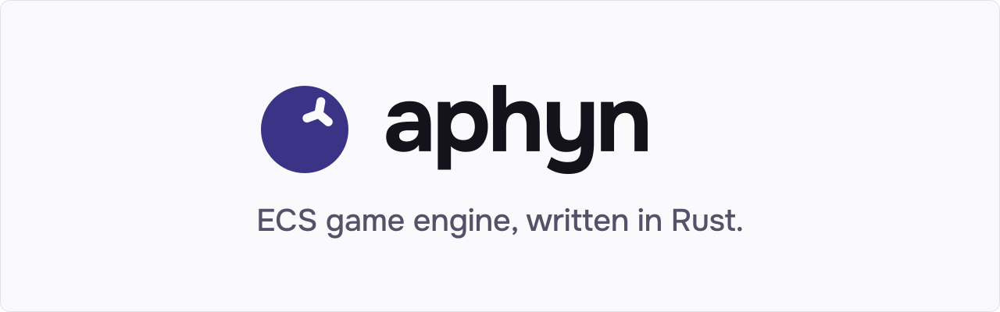
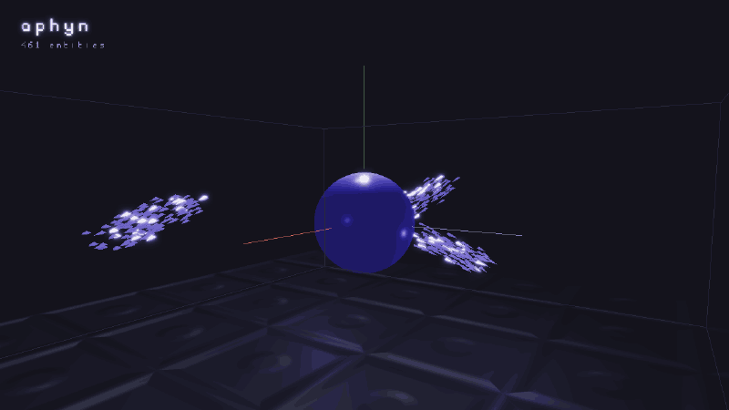

<p align="center">
  <picture>
    <source media="(prefers-color-scheme: dark)" srcset="assets/readme/hero-dark.svg">
    
  </picture>
</p>

<p align="center">
  <a href="#license"></a>
  <a href="#quick-start"></a>
  <a href="https://docs.aphyn.org/"></a>
</p>

<p align="center">
  A 3D engine that are-you-fruits-studio builds for its own games, open for anyone to read, run and build on.
</p>

<p align="center">
  
</p>

## Why Aphyn

- **Focused crates.** One Cargo workspace of small crates, all source open.
- **Data first.** Systems declare the data they touch; the scheduler runs them in parallel across CPU cores.
- **Grown from real games.** Aphyn started as the studio's in-house Fruits Engine. Features land when a game needs them.
- **Licensing that stays put.** MIT OR Apache-2.0. No royalties, no account, no terms that change under you.

## Status

> [!WARNING]
> **Early development. The API will change.** Pin a [release tag](https://github.com/are-you-fruits-studio/aphyn/releases) if you build on Aphyn.

**Platforms:** Windows (DirectX 12) and Linux (Vulkan), x86_64. Rendering through [wgpu](https://wgpu.rs).

**In development:** the editor, built on the engine itself. Release builds ship it as the `aphyn` binary.

**Not yet:** joints · animation · point-light shadows · skybox · profiler · editor docking · live reload for assets and scripts.

The working list lives in [`todos.md`](todos.md).

## Features

- **ECS:** systems scheduled by data access, run in parallel
- **Rendering:** wgpu, lit materials, normal maps, bloom, debug line gizmos
- **UI:** text, images, alignment, masks
- **Audio:** clip playback through cpal
- **Collision detection:** point, line, AABB, oriented box, sphere, triangle
- **Physics:** rigidbodies with friction and restitution, compound bodies, collision layers, raycasts
- **Prefabs and scenes:** saved and loaded as JSON
- **Game builds:** `aphyn build` packs a launcher, your game library and its assets

## Quick start

Requirements: the latest stable Rust (edition 2024). Aphyn relies on recent language features, so run `rustup update` before building. On Linux (Debian/Ubuntu):

```bash
sudo apt-get update && sudo apt-get install -y libasound2-dev libudev-dev pkg-config
```

The examples live in [aphyn.examples](https://github.com/are-you-fruits-studio/aphyn.examples). Run one with [just](https://github.com/casey/just) (its README also shows the plain `cargo` command):

```bash
git clone https://github.com/are-you-fruits-studio/aphyn.examples.git
cd aphyn.examples
just dev cubes
```

The first build takes a few minutes.

A minimal app: one resource, two systems, the default engine modules.

```rust
use aphyn::*;

#[derive(Resource)]
struct Frames {
    count: u64,
}

fn setup(mut world: WorldDataMut) {
    world.as_mut().resources_mut().insert(Frames { count: 0 });
}

fn tick(mut frames: ResMut<Frames>) {
    frames.count += 1;
}

fn main() {
    // adds the default engine modules, then hands you the world to register your own systems
    launch_app_statically(|mut ctx| {
        ctx.behavior.get_mut(Schedule::Start).insert_system(setup);
        ctx.behavior.get_mut(Schedule::Update).insert_system(tick);
    });
}
```

It opens an empty window: add a camera and a mesh to see something — see the `cubes` example in [aphyn.examples](https://github.com/are-you-fruits-studio/aphyn.examples). The [Quick start](https://docs.aphyn.org/docs/getting-started) guide walks through it.

To ship a game as a launcher plus a game library, see [Build a game](#build-a-game).

## Build a game

A shipped game is a small launcher, your game compiled as a dynamic library, and its `assets/`. The `aphyn` binary from [GitHub Releases](https://github.com/are-you-fruits-studio/aphyn/releases) packs them:

```bash
aphyn build path/to/my_game
```

The project layout, the game crate and how the launcher loads it: [Build a game](https://docs.aphyn.org/docs/build-a-game) on docs.aphyn.org.

## Examples

Examples and demo projects live in a separate repository, [aphyn.examples](https://github.com/are-you-fruits-studio/aphyn.examples). Each one is a standalone project that you can run with `cargo` or package with `aphyn build`.

## Docs · community · contributing

- **Docs:** [docs.aphyn.org](https://docs.aphyn.org/)
- **Questions and bugs:** [GitHub Issues](https://github.com/are-you-fruits-studio/aphyn/issues)
- **Contributing:** external pull requests are not accepted for now. See [`CONTRIBUTING.md`](CONTRIBUTING.md).

## About the name

Aphyn comes from *а́фини* (áfyny), the Carpathian word for bilberries (wild European blueberries). The logo is a berry whose calyx is the X, Y and Z axes.

## License

Licensed under either of

- Apache License, Version 2.0 ([LICENSE-APACHE](LICENSE-APACHE) or <https://www.apache.org/licenses/LICENSE-2.0>)
- MIT license ([LICENSE-MIT](LICENSE-MIT) or <https://opensource.org/licenses/MIT>)

at your option.

Unless you explicitly state otherwise, any contribution intentionally submitted for inclusion in the work by you, as defined in the Apache-2.0 license, shall be dual licensed as above, without any additional terms or conditions.
