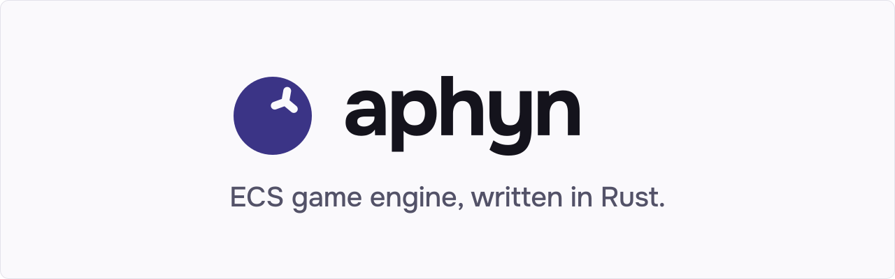
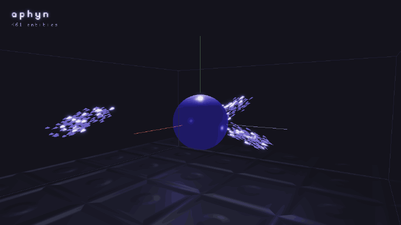

<!-- Social preview: upload assets/readme/social-preview.png in Settings → General → Social preview. -->

<p align="center">
  <picture>
    <source media="(prefers-color-scheme: dark)" srcset="assets/readme/hero-dark.svg">
    
  </picture>
</p>

<p align="center">
  <a href="#license"></a>
  <a href="#quick-start"></a>
  <!-- TODO: docs badge once the docs site is redeployed after the rename. -->
  <!-- TODO: CI badge once a workflow runs on push (build.yml is manual-only today). Discord badge if the studio opens one. -->
</p>

<p align="center">
  A 3D engine that are-you-fruits-studio builds for its own games, open for anyone to read, run and build on.
</p>

<p align="center">
  
</p>

## Why Aphyn

- **Focused crates.** One Cargo workspace of small crates, all source open.
- **Data first.** Systems declare the data they touch; the scheduler runs them in parallel across CPU cores.
- **Grown from real games.** Aphyn started as the studio's in-house Fruits Engine. Features land when a game needs them.
- **Licensing that stays put.** MIT OR Apache-2.0. No royalties, no account, no terms that change under you.

## Status

> [!WARNING]
> **Early development. The API will change.** Pin a [release tag](https://github.com/are-you-fruits-studio/aphyn/releases) if you build on Aphyn.

<!-- TODO: before publishing, enable Vulkan in crates/render_core/src/render_api.rs (currently Backends::DX12 only). -->
**Platforms:** Windows (DirectX 12) and Linux (Vulkan), x86_64. Rendering through [wgpu](https://wgpu.rs).

**In development:** the editor, built on the engine itself. Release builds ship it as the `aphyn` binary.

**Not yet:** physics · animation · shadows · skybox · screen-space reflections · profiler · editor docking · live reload for assets and scripts.

The working list lives in [`todos.md`](todos.md).

## Features

- **ECS:** systems scheduled by data access, run in parallel
- **Rendering:** wgpu, lit materials, normal maps, bloom, debug line gizmos
- **UI:** text, images, alignment, masks
- **Audio:** clip playback through cpal
- **Collision detection:** point, line, AABB, oriented box, sphere, triangle
- **Prefabs and scenes:** saved and loaded as JSON
- **Game builds:** `aphyn build` packs a launcher, your game library and its assets

## Quick start

Requirements: the latest stable Rust (edition 2024). Aphyn relies on recent language features, so run `rustup update` before building. On Linux (Debian/Ubuntu):

```bash
sudo apt-get update && sudo apt-get install -y libasound2-dev libudev-dev pkg-config
```

Run an example:

```bash
git clone https://github.com/are-you-fruits-studio/aphyn.git
cd aphyn
cargo run --release -p aphyn_example_cubes
```

The first release build can take a long time (over an hour from a cold cache).

A minimal app: one resource, two systems, the default engine modules.

```rust
use aphyn::*;

#[derive(Resource)]
struct Frames {
    count: u64,
}

fn setup(mut world: WorldDataMut) {
    world.as_mut().resources_mut().insert(Frames { count: 0 });
}

fn tick(mut frames: ResMut<Frames>) {
    frames.count += 1;
}

fn main() {
    let mut app = App::new();
    let world = app.ecs_mut();

    add_defult_modules_to(world.as_mut());
    world.behavior_mut().get_mut(Schedule::Start).insert_system(setup);
    world.behavior_mut().get_mut(Schedule::Update).insert_system(tick);

    app.run();
}
```

It opens an empty window: add a camera and a mesh to see something — see the `cubes` example.

To ship a game as a launcher plus a game library, see [Build a game](#build-a-game).

## Build a game

A shipped game is two crates in one project folder: `launcher/`, a tiny binary, and `scripts/`, your game built as a `cdylib` named `lib_app`.

`scripts/Cargo.toml`:

```toml
[lib]
name = "lib_app"
crate-type = ["cdylib"]

[dependencies]
aphyn = { git = "https://github.com/are-you-fruits-studio/aphyn", tag = "v0.18.0" }
```

Use the same tag as the `aphyn` binary you build with — the launcher and the game library must match. Tags before `v0.18.0` still use the old package name.

`scripts/src/lib.rs` exports the setup function:

```rust
use aphyn::*;

fn setup(ctx: AppInitCtx) {
    // Register your components, systems and resources on `ctx.world`.
    ctx.window.title = "My game".into();
}

aphyn::aphyn_entry_point!(setup);
```

`launcher/src/main.rs` loads it:

```rust
fn main() {
    aphyn::launch_app_dynamically();
}
```

Then build with the `aphyn` binary. Download it from [GitHub Releases](https://github.com/are-you-fruits-studio/aphyn/releases) (`v0.18.0` or newer):

```bash
aphyn build path/to/my_game
```

or run it from source:

```bash
cargo run --release -p aphyn_editor -- build path/to/my_game
```

This compiles both crates and copies the launcher, `lib_app` and `assets/` into `path/to/my_game/builds/`. The executable is named after the project folder (`my_game`). It needs `cargo` in your `PATH`. On Windows, keep the project path short (MSVC's 260-character path limit) and without spaces.

## Examples

Each example is its own crate under [`crates/example/`](crates/example). Run these from the repo root:

```bash
cargo run --release -p aphyn_example_cubes
```

Replace `cubes` with any name below:

[cubes](crates/example/cubes) · [boids](crates/example/boids) · [ecs](crates/example/ecs) · [gizmos](crates/example/gizmos) · [collisions](crates/example/collisions) · [text](crates/example/text) · [ui](crates/example/ui) · [normals](crates/example/normals)

Currently broken: [bloom](crates/example/bloom) · [audio_screen_saver](crates/example/audio_screen_saver)

## Docs · community · contributing

<!-- TODO: link the docs site once it is redeployed after the rename. -->
- **Docs:** in progress ([`docs/`](docs))
- **Questions and bugs:** [GitHub Issues](https://github.com/are-you-fruits-studio/aphyn/issues) <!-- TODO: add Discussions / Discord if enabled. -->
- **Contributing:** read [`CONTRIBUTING.md`](CONTRIBUTING.md) before opening a pull request. <!-- TODO: state whether external PRs are accepted. -->

## About the name

Aphyn comes from *а́фини* (áfyny), the Carpathian word for bilberries (wild European blueberries). The logo is a berry whose calyx is the X, Y and Z axes.

## License

Licensed under either of

- Apache License, Version 2.0 ([LICENSE-APACHE](LICENSE-APACHE) or <https://www.apache.org/licenses/LICENSE-2.0>)
- MIT license ([LICENSE-MIT](LICENSE-MIT) or <https://opensource.org/licenses/MIT>)

at your option.

Unless you explicitly state otherwise, any contribution intentionally submitted for inclusion in the work by you, as defined in the Apache-2.0 license, shall be dual licensed as above, without any additional terms or conditions.

<!-- TODO: add LICENSE-MIT and LICENSE-APACHE to the repo before publishing; neither exists on dev yet.
     Confirm the origin of bundled assets (crates/ui/src/assets/ascii_px_*.png, crates/example/normals/assets/normal_map.png)
     and either state they are under the same terms or list them in CREDITS.md. -->
